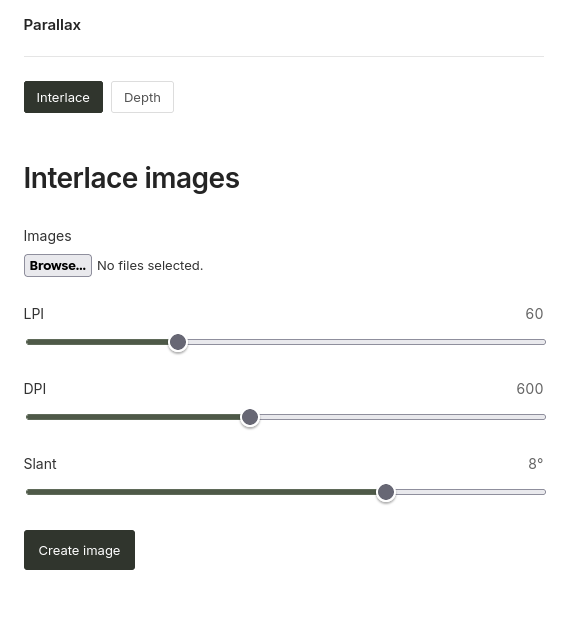
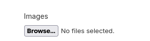

<div align="center">

# Parallax

[](LICENSE)


[](https://eraxty.blitz.cloud/)


[Live site](https://eraxty.blitz.cloud/) • [Features](#features) • [Install](#installation) • [Usage](#usage)



</div>

---

## Why Parallax
Soo i once saw a video about a lenovo laptop and how it was hands free 3d display i wanted to recreate that and i researced about it and found out it uses lenticular lenses and ir camera. I still wanted to try to do it but couldnt i could only get the interlacing of images works and thats what this is now you can interlace your images according to your lenticular sheet and get the 3d effect also parallax has a depth viewer as i wanted to make use of the camera too but since the plan changed mid way i build that 

## Features

- Interlace 2 or more images into one PNG ready to print under a lenticular sheet for 3d effect
- Match your sheet with LPI, DPI, and slant sliders, so slanted lenses work too.
- Mix image sizes freely. Every image is cropped to fit the first one.
- depth viewer (its kinda trash rn)

## Installation

Use it [Here](https://eraxty.blitz.cloud/).

## Local
You need:

- Python 3.10+
- Node.js 22+
- A webcam (only for face tracking in the depth preview (optional))

```bash
git clone https://github.com/Eraxty/Parallax
cd Parallax
python -m venv .venv
source .venv/bin/activate
pip install -r requirements.txt
cd Front
npm install
npm run dev
```

The first depth preview downloads the Depth Anything V2 model (about 27 MB), so it needs internet and takes a moment.

## Deploy
Parallax runs on [Vercel](https://vercel.com/new): the React site is static and the Python backend runs as Vercel Functions from `api/`. Import the repo, leave the Root Directory as the repo root, and deploy. `vercel.json` handles the rest.

Vercel limits uploads and responses to 4.5 MB, so keep the images you interlace small enough.


## Usage

1) just click the browse button
 

2) select 2 or more images 
3) change the sliders according to your sheet
4) click Create image

## Credits
- Depth estimation: [Depth Anything V2](https://github.com/DepthAnything/Depth-Anything-V2) through [ONNX Runtime](https://onnxruntime.ai)
- Face tracking: [MediaPipe Face Landmarker](https://ai.google.dev/edge/mediapipe/solutions/vision/face_landmarker)
- Eye tracking (prototype): [screen-eye-tracking](https://github.com/PINTO0309/screen-eye-tracking)

## License

[MIT](LICENSE)
